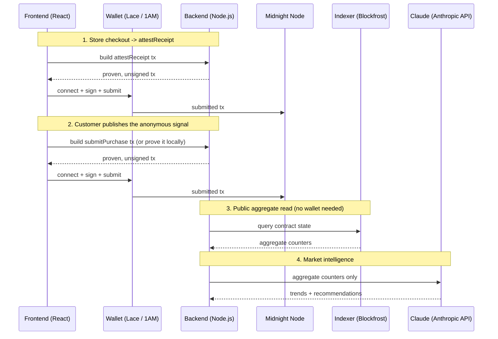

<p align="center">
  
</p>

# AEGIS - Private Commerce Intelligence on Midnight

Market intelligence powered by anonymous ZK signals. Stores see what customers want. Customers stay invisible.

## What is Aegis?

Aegis is a privacy-preserving market intelligence system built on Midnight Network. It solves a fundamental tension in commerce: stores need to know what customers want, but customers don't want to be tracked.

**How it works:**

- A store attests a real purchase on-chain (proof of membership in a registered-stores tree, no store identity revealed) and seals a commitment to the receipt. The customer gets the receipt as a QR.
- The customer scans it with their phone, where it's kept alongside all their other receipts, and publishes a signal: a ZK proof that reveals only the subcategory and quantity, never the amount, the date, or which store. The blockchain only knows "one more person bought in electronics", never who.
- The proof can be generated on Aegis servers or on the customer's own local proof server, so the receipt never has to leave their device.
- The aggregate state (total signals per category) is public and verifiable on-chain.
- An LLM agent reads the aggregate and generates market intelligence, trending categories, insights, and recommendations tailored to each store over the last week, month, 3 months or year, without ever accessing individual user data.
- Stores create targeted campaigns with a minimum signal threshold. When enough signals accumulate in a category, their campaign activates.

## Try it

Everything runs against Midnight's **Preprod** testnet. There are two ways to try it.

### Option A: hosted version

Open **[aegis-midnight.vercel.app](https://aegis-midnight.vercel.app/)**. It's connected to a shared contract on Preprod that already has a registered store and signals, so you only need a Midnight wallet extension (Lace or 1AM) on the Preprod network.

1. **Connect Wallet**.
2. In the **Store** tab, add a couple of products to the cart and check out. This seals a receipt on-chain and shows it as a QR.
3. Publish the signal, in either of these ways:
   - Scan the QR with your phone (open the same site on it and tap **Scan receipt**). While sponsorship is on, the phone doesn't need a wallet.
   - Or switch to the **User** tab on the same computer: the receipt you just sealed shows up in the phone as a new ticket. Tap **Publish signal**.
4. Review what will be shared, choose where the proof is generated (see below) and publish. Watch the category counter bump in the stats ribbon.

On the hosted version, Aegis can sponsor the signal's transaction fee, so the customer doesn't need DUST to publish.

### Option B: run it locally

When you run it yourself, you deploy your own contract instance from the browser and become its store admin, so the full loop (register store, seal a receipt, publish a signal) works standalone, with no coordination needed.

**Prerequisites**

- Node.js >= 22
- A Midnight proof server reachable at `http://127.0.0.1:6300`
- The Compact CLI (`compact`) installed and on your `PATH`, to compile the contract
- A Midnight wallet extension (Lace or 1AM) with some Preprod NIGHT/DUST
- An `ANTHROPIC_API_KEY` (optional), only needed for the market intelligence (insights) endpoints; the purchase/signal flow works without it

**Steps**

```bash
git clone https://github.com/Leyenda95/aegisProject.git
cd aegisProject
npm install                # installs contract, backend and frontend workspaces
cd contract
npm run compact            # compiles the contract, generates ZK keys -> managed/aegis/
cd ../backend
npm run start:preprod      # starts the API against Preprod. No contract deployed yet
cd ../frontend
npm run dev                # starts the frontend, open the printed URL
```

1. Install dependencies: `npm install` at the repo root (npm workspaces cover `contract`, `backend`, and `frontend`).
2. Compile the contract: `cd contract && npm run compact` (generates the ZK keys under `contract/managed/`).
3. Start the backend against Preprod: `cd backend && npm run start:preprod` (set `ANTHROPIC_API_KEY` in `backend/.env` first if you want insights). No contract is deployed yet at this point, that happens from the browser next.
4. Start the frontend: `cd frontend && npm run dev`, then open the printed URL.
5. In the browser: **Connect Wallet** (Lace or 1AM, Preprod network) → **Deploy contract** (this deploys a fresh instance and makes your wallet its store admin; the backend remembers it for next time) → **Register demo store** → **Load demo data** (seeds baseline counters so the store insights have something to talk about).
6. Try the flow: in the **Store** tab, check out a cart. Switch to the **User** tab, tap **Publish signal** on the new ticket, review what will be shared and publish.

### Prove on your own device (optional)

By default the backend generates the signal's proof, which means the receipt travels to it. When publishing, you can choose **Local** instead of **Aegis Proof Server**: the browser then builds the `submitPurchase` transaction itself and proves it with a proof server running on your machine, so the receipt never leaves your device. Start one with:

```bash
docker run -p 6300:6300 midnightntwrk/proof-server:8.1.3
```

The backend then only serves the public contract state (`GET /contract-states`) and, if sponsorship is on, forwards the already proven transaction (`POST /sponsor-signal`, which only accepts a single `submitPurchase` call to this contract).

## Architecture



**Flow:**

1. A store checks out a cart in the frontend; the backend builds the `attestReceipt` circuit call (proof of membership in the registered-stores tree, no store identity revealed) and generates the ZK proof. The customer's receipt (subcategory lines, amounts, timestamp) is never published as plaintext, only its commitment gets sealed on-chain.
2. From that receipt, the customer builds and submits `submitPurchase`: either the backend or the customer's own local proof server proves the circuit, and the connected wallet (Lace or 1AM, via the Midnight DApp Connector API) balances, signs, and submits it to the Midnight node. Only the subcategory and quantity are revealed, no identity, no amount, no store.
3. Aggregate state (`GET /state`) is public ledger data. The backend reads it from the Preprod indexer, served by Blockfrost (its token stays server-side), and decodes it with the contract's own `ledger()` function. No proof, no key, no privileged access involved.
4. For the store side, the backend feeds the aggregate counters to Claude (Anthropic API), which returns trending categories and actionable recommendations over 1W, 1M, 3M and 1Y windows. The model only ever sees aggregate numbers, never individual signals or user data.
5. Stores register campaigns on-chain (`registerCampaign`) through the same build-tx-then-wallet-submit flow, and the backend matches campaign thresholds against live state (`/match/:id`), again using Claude to explain the reasoning.

## Stack

| Layer | Technology |
|---|---|
| Smart contract | [Compact](https://docs.midnight.network/compact) (compiler `0.31.1`, language `>= 0.20`, runtime `0.16.0`) |
| Contract tests | Vitest, in-memory circuit simulator |
| Backend | Node.js + TypeScript (`tsx`), native `http` server, `@midnight-ntwrk/midnight-js-contracts`, `@midnight-ntwrk/ledger-v8` |
| Market intelligence | Claude (Anthropic Messages API) |
| Frontend | React 18 + Vite 6 + TypeScript |
| Wallet integration | Midnight DApp Connector API, Lace and 1AM |
| Network | Midnight Preprod (node + Blockfrost indexer), hosted or local proof server |
| Hosting | Frontend on Vercel, backend and proof server on Railway |
| Local devnet | Docker Compose (node + indexer + proof server) |

## Project status

- [x] Anonymous category/subcategory signal circuit (`contract/aegis.compact`)
- [x] Store registration and receipt attestation (`registerStore`, `attestReceipt`), anonymous membership via `HistoricMerkleTree`
- [x] Simulator + tests (`contract/`)
- [x] Backend: transaction builder/prover + market intelligence agent
- [x] Frontend: store and user views, wallet integration (Lace/1AM), selective-disclosure preview before publishing a signal
- [x] Customer phone view: new tickets, receipt history and spending by category, all kept on the device
- [x] Scan the receipt QR from a mobile phone and publish the signal from it
- [x] Prove the signal on your own local proof server, so the receipt never leaves your device
- [x] Sponsored signal transactions: Aegis can pay the fee so customers don't need DUST
- [x] Aggregate state goes through the backend (`GET /state`): the Preprod indexer is served by Blockfrost and its token must stay server-side. The frontend no longer loads the contract's ~11MB WASM runtime just to read the counters.
- [ ] Optional age/spend disclosure tied to a pseudonym: previewed in the UI, not wired into the contract yet. `submitPurchase` today only ever reveals subcategory and quantity, regardless of what's toggled in the preview.

## What's next

- **Selective disclosure in the circuit.** Wire age range and average spend into the circuit, tied to a persistent pseudonym. A store can then recognize a returning customer and reward them with discounts, gifts or exclusive offers, without ever learning who they are. Sharing always stays opt-in: the customer decides what to reveal and to whom.
- **Campaigns.** A store defines a target category and a signal threshold, and the campaign activates automatically once enough signals land.
- **Stronger unlinkability.** Move sealed receipts into their own Merkle tree, so the customer proves membership with a nullifier instead of revealing the commitment.
- **Point of sale integrations.** Plug into the systems stores already use, like Shopify. A store installs an app, and from then on every checkout seals its receipt automatically and prints or emails the QR. That's how AEGIS stops being a demo and becomes something any shop, from a corner café to an online brand, can switch on in minutes.
